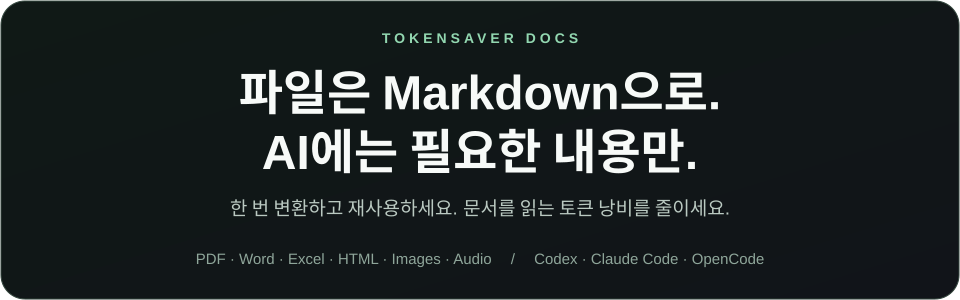

<p align="center"></p>

<p align="center">
<a href="#download"></a>
<a href="#download"></a>
<a href="#source-install"></a>
</p>
<p align="center"><a href="#download">macOS Intel</a> · <a href="https://github.com/winter0123/tokensaver-docs/releases">All releases</a></p>

<p align="center"><a href="README.md">English</a> · <a href="README.zh-CN.md">简体中文</a> · <a href="README.ja.md">日本語</a> · <a href="README.ko.md">한국어</a></p>

**PDF·Word·Excel·HTML·이미지·음성을 Markdown으로 바꿔 Codex·Claude Code·OpenCode에서 재사용하세요.**

아래 운영체제 버튼을 누른 뒤 사용할 에이전트의 ZIP을 받으세요. Linux는 현재 소스 설치를 제공합니다.

<a id="download"></a>

## 플러그인 다운로드 — v0.4.0 미리보기

**내 운영체제와 사용할 에이전트가 만나는 파일을 받으세요.** Python을 따로 설치할 필요가 없습니다.

| 운영체제 | Claude Code | Codex | OpenCode |
| --- | --- | --- | --- |
| macOS Apple Silicon | [ZIP](https://github.com/winter0123/tokensaver-docs/releases/download/v0.4.0/tokensaver-docs-claude-darwin-arm64.zip) | [ZIP](https://github.com/winter0123/tokensaver-docs/releases/download/v0.4.0/tokensaver-docs-codex-darwin-arm64.zip) | [ZIP](https://github.com/winter0123/tokensaver-docs/releases/download/v0.4.0/tokensaver-docs-opencode-darwin-arm64.zip) |
| macOS Intel | [ZIP](https://github.com/winter0123/tokensaver-docs/releases/download/v0.4.0/tokensaver-docs-claude-darwin-x64.zip) | [ZIP](https://github.com/winter0123/tokensaver-docs/releases/download/v0.4.0/tokensaver-docs-codex-darwin-x64.zip) | [ZIP](https://github.com/winter0123/tokensaver-docs/releases/download/v0.4.0/tokensaver-docs-opencode-darwin-x64.zip) |
| Windows x64 | [ZIP](https://github.com/winter0123/tokensaver-docs/releases/download/v0.4.0/tokensaver-docs-claude-win32-x64.zip) | [ZIP](https://github.com/winter0123/tokensaver-docs/releases/download/v0.4.0/tokensaver-docs-codex-win32-x64.zip) | [ZIP](https://github.com/winter0123/tokensaver-docs/releases/download/v0.4.0/tokensaver-docs-opencode-win32-x64.zip) |

압축을 풀고 **압축을 푼 폴더에서 터미널을 열어**, 선택한 에이전트의 이름을 넣어 실행하세요.

```sh
./bin/tokensaver-docs install-plugin . --agent claude
```

Codex는 `--agent codex`, OpenCode는 `--agent opencode`를 사용합니다. Windows PowerShell에서는 명령 앞부분을 `.\bin\tokensaver-docs.exe`로 바꾸세요. 설치한 뒤 에이전트를 재시작하고 **“tokensaver-docs로 이 파일을 Markdown으로 변환해줘: /파일경로”**라고 요청하세요. 모델 선택은 플러그인이 안내하며, 변경하려면 **“tokensaver-docs의 이미지 변환 모델을 변경해줘”**라고 요청하세요.

macOS arm64는 로컬 설치를 확인했습니다. Intel Mac·Windows는 자동 번들 검사만 통과했으며 실제 에이전트 설치는 실험적입니다. 바이너리는 서명·공증 전입니다. Linux는 아래 소스 설치를 사용하세요. 공식 마켓 등록은 별도 준비 중입니다.

[릴리스 설명·체크섬·설치 스크립트](https://github.com/winter0123/tokensaver-docs/releases/tag/v0.4.0)


<a id="source-install"></a>

## 소스 CLI 설치

**내 컴퓨터의 운영체제 하나만 선택하세요.** Python 3.11 이상과 Git이 필요합니다.

<details open>
<summary><strong>macOS / Linux — 터미널에 복사</strong></summary>

```sh
python3 -m venv "$HOME/.tokensaver-docs/venv"
source "$HOME/.tokensaver-docs/venv/bin/activate"
python -m pip install 'tokensaver-docs[mcp,tokens] @ git+https://github.com/winter0123/tokensaver-docs.git'
```

새 터미널을 열면 두 번째 줄을 다시 실행하세요.

</details>

<details>
<summary><strong>Windows — PowerShell에 복사</strong></summary>

```powershell
py -3 -m venv "$HOME\.tokensaver-docs\venv"
& "$HOME\.tokensaver-docs\venv\Scripts\Activate.ps1"
python -m pip install 'tokensaver-docs[mcp,tokens] @ git+https://github.com/winter0123/tokensaver-docs.git'
```

새 터미널을 열면 두 번째 줄을 다시 실행하세요. 활성화가 차단되면 정책을 바꾸는 대신 `& "$HOME\.tokensaver-docs\venv\Scripts\tokensaver-docs.exe"`를 이후 명령의 `tokensaver-docs` 대신 사용하세요.

</details>

## 모델 선택·변경

**아래 명령은 소스 CLI 사용자용입니다.** 플러그인 사용자는 위 안내처럼 에이전트에게 모델 변경을 요청하세요. 이미지 속 글자와 설명이 필요할 때, 아래 세 가지 중 하나만 선택하세요. 설치한 환경이 활성화된 터미널에서 실행합니다. 처음 선택할 때와 나중에 변경할 때 같은 명령을 사용하며, 선택한 모델을 기본값으로 저장합니다.

<details>
<summary><strong>① Claude Code — 로그인한 CLI의 모델 사용</strong></summary>

Claude Code CLI를 설치하고 로그인한 상태에서 실행하세요. 실행 후 **해당 계정에서 사용할 정확한 모델 이름**을 입력합니다.

```sh
tokensaver-docs configure --kind image --provider claude
```

</details>

<details>
<summary><strong>② Codex — 로그인한 CLI의 모델 사용</strong></summary>

Codex CLI를 설치하고 로그인한 상태에서 실행하세요. 실행 후 **해당 계정에서 사용할 정확한 모델 이름**을 입력합니다.

```sh
tokensaver-docs configure --kind image --provider codex
```

</details>

<details>
<summary><strong>③ OpenCode + OpenRouter — 무료 모델 목록에서 선택</strong></summary>

`OPENROUTER_API_KEY` 환경변수를 설정한 뒤 실행하세요. **무료 이미지 입력 지원 후보 목록에서 번호를 선택**합니다. 실제 사용 가능 여부는 계정과 서비스 상태에 따라 달라집니다. 키를 에이전트 대화에 입력하지 마세요.

```sh
tokensaver-docs configure --kind image --provider openrouter
```

OpenCode는 에이전트, OpenRouter는 모델 제공 서비스입니다. 이 명령은 OpenCode의 대화 모델을 바꾸지 않습니다. Claude Code·Codex에서도 OpenRouter를 변환 제공자로 선택할 수 있습니다.

</details>

이미지 없는 문서의 글자는 모델·API 키 없이 추출합니다. 위 설정은 **이미지 변환 모델**에만 적용하며, 에이전트의 대화 모델과 음성 모델은 별개입니다. Claude Code·Codex 방식은 각 CLI의 로그인·사용량 한도·과금 조건을 따릅니다.

현재 모델 확인: `tokensaver-docs setup-model`

## 사용법

`./documents`를 파일 또는 폴더 경로로 바꾸세요. 결과는 `./converted`에 저장됩니다. **예: `안내.html` → `converted/안내.html.md`**

**글자는 추출하고, 이미지 위치는 `[이미지]`로 표시**

```sh
tokensaver-docs prepare "./documents" --output "./converted" --image-mode placeholder
```

**이미지·이미지 속 글자·설명까지 추가** — 모델 설정 후 실행하며, 이미지가 선택한 제공자로 전송됩니다.

```sh
tokensaver-docs prepare "./documents" --output "./converted" --image-mode analyze
```

Claude Code·Codex의 이미지 지원 여부는 자동 확인하지 못합니다. 선택한 모델의 이미지 지원을 직접 확인한 경우에만 위 명령 끝에 `--allow-unverified-model`을 추가하세요. 알려진 이미지 미지원 모델은 허용하지 않습니다. 음성 변환은 [상세 사용법](docs/advanced-usage.ko.md)에서 별도로 설정하세요.

기존 Markdown과 사용자 수정 내용은 덮어쓰지 않습니다. 같은 문서와 완료된 이미지 분석은 캐시에서 재사용합니다.

## 지원 파일

| 파일 | 확장자 | 변환 내용 |
| --- | --- | --- |
| PDF | `.pdf` | 텍스트, 선택한 스캔 페이지의 이미지 분석 |
| Word | `.docx` | 텍스트·표·포함 이미지 |
| Excel | `.xlsx` | 시트·셀·포함 이미지 |
| HTML | `.html`, `.htm` | 본문·표·포함 이미지 |
| 이미지 | `.png`, `.jpg`, `.jpeg`, `.webp`, `.bmp`, `.tif`, `.tiff`, `.gif` | 이미지 보존, 선택한 모델로 글자·설명 추가 |
| 음성·동영상의 음성 | `.wav`, `.mp3`, `.m4a`, `.ogg`, `.flac`, `.aac`, `.mp4` | 음성을 글자로 변환; 동영상 화면은 분석하지 않음 |

`.doc`, `.xls`는 지원하지 않습니다. 이미지와 음성의 결과 품질은 모델에 따라 달라집니다. 토큰 절감 효과는 문서와 읽는 범위에 따라 달라지며, 측정 방법과 한계는 [벤치마크](benchmarks/README.md)를 참고하세요.

## 더 알아보기

[에이전트 연결·검색·음성·개발자 사용법](docs/advanced-usage.ko.md) · [플러그인 설치·배포](docs/distribution.md) · [검증 상태](docs/current-status.md) · [문제 신고](https://github.com/winter0123/tokensaver-docs/issues) · [MIT 라이선스](LICENSE)
