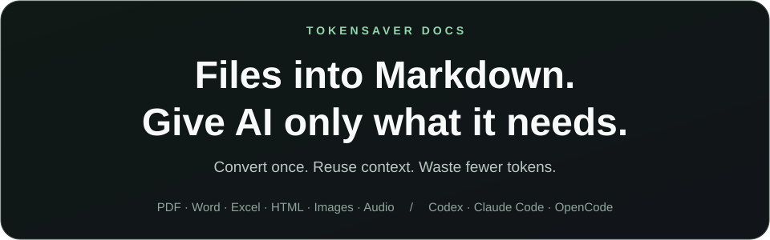

<p align="center"></p>

<p align="center">Created by <a href="https://github.com/winter0123">winter0123</a> · <a href="https://github.com/winter0123/tokensaver-docs">Original repository</a> · <a href="AUTHORS.md">Authors</a> · <a href="LICENSE">MIT License</a></p>

<p align="center">
<a href="https://github.com/winter0123/tokensaver-docs/releases/download/v0.5.4/tokensaver-docs-win32-x64.zip?download=1"></a>
<a href="https://github.com/winter0123/tokensaver-docs/releases/download/v0.5.4/tokensaver-docs-darwin-arm64.zip?download=1"></a>
<a href="https://github.com/winter0123/tokensaver-docs/releases/download/v0.5.4/tokensaver-docs-darwin-x64.zip?download=1"></a>
</p>
<p align="center"><a href="https://github.com/winter0123/tokensaver-docs/releases">All releases</a></p>

<p align="center"><a href="README.md">English</a> · <a href="README.zh-CN.md">简体中文</a> · <a href="README.ja.md">日本語</a> · <a href="README.ko.md">한국어</a></p>

**Convert documents, images and audio into reusable Markdown for Codex, Claude Code and OpenCode. The updated source also archives project research and retrieves short, cited excerpts.**

Click your OS button to download, then choose your agent in the installer.

<a id="download"></a>

## Download and install — v0.5.4

Extract the entire ZIP and run the installer once. Select the installed Codex, Claude Code, or OpenCode agents to register. No separate Python is needed.

macOS: double-click `install.command`, or run `sh install.command` in the extracted folder.

Windows: open PowerShell in the extracted folder and run `.\install.ps1`. If device policy blocks it, follow your device policy; the installer does not change it.

Install the CLI for your chosen agent first, then restart the agent after installing the plugin.

macOS arm64 installer was exercised locally. Windows/Intel Mac passed binary bundle tests; the unified Windows launcher and real Windows/Intel host installation remain experimental. Binaries are unsigned/not notarized. Linux currently has source installation only.

### Install from a terminal

Paste the command for your OS. It downloads and verifies the installer bundle, then shows the detected agents. Use Tab or the arrow keys to move, Space to check or uncheck agents, and Enter to install the checked agents. The installer registers the selected agents as plugins.

**macOS**

```sh
curl -fsSL --proto '=https' 'https://github.com/winter0123/tokensaver-docs/releases/download/v0.5.4/install.sh' -o tokensaver-docs-install.sh && sh tokensaver-docs-install.sh --repo winter0123/tokensaver-docs --version v0.5.4
```

**Windows PowerShell**

```powershell
& { $ProgressPreference = 'SilentlyContinue'; Invoke-WebRequest 'https://github.com/winter0123/tokensaver-docs/releases/download/v0.5.4/install.ps1' -OutFile tokensaver-docs-install.ps1 -ErrorAction Stop; & .\tokensaver-docs-install.ps1 -Repo winter0123/tokensaver-docs -Version v0.5.4 }
```

<details>
<summary>Advanced: individual agent archives</summary>

| Operating system | Claude Code | Codex | OpenCode |
| --- | --- | --- | --- |
| macOS Apple Silicon | [ZIP](https://github.com/winter0123/tokensaver-docs/releases/download/v0.5.4/tokensaver-docs-claude-darwin-arm64.zip) | [ZIP](https://github.com/winter0123/tokensaver-docs/releases/download/v0.5.4/tokensaver-docs-codex-darwin-arm64.zip) | [ZIP](https://github.com/winter0123/tokensaver-docs/releases/download/v0.5.4/tokensaver-docs-opencode-darwin-arm64.zip) |
| macOS Intel | [ZIP](https://github.com/winter0123/tokensaver-docs/releases/download/v0.5.4/tokensaver-docs-claude-darwin-x64.zip) | [ZIP](https://github.com/winter0123/tokensaver-docs/releases/download/v0.5.4/tokensaver-docs-codex-darwin-x64.zip) | [ZIP](https://github.com/winter0123/tokensaver-docs/releases/download/v0.5.4/tokensaver-docs-opencode-darwin-x64.zip) |
| Windows x64 | [ZIP](https://github.com/winter0123/tokensaver-docs/releases/download/v0.5.4/tokensaver-docs-claude-win32-x64.zip) | [ZIP](https://github.com/winter0123/tokensaver-docs/releases/download/v0.5.4/tokensaver-docs-codex-win32-x64.zip) | [ZIP](https://github.com/winter0123/tokensaver-docs/releases/download/v0.5.4/tokensaver-docs-opencode-win32-x64.zip) |

</details>

## Attach a file and ask

Attach a file or image to your chat and ask in your own words.

> Turn this file into a Markdown file.

> Put the text in this image and a description of it into a Markdown file.

When your agent can open the attachment, the tool uses the original name and a default destination, then tells you where it saved the Markdown. Answer any first-use image model or analysis prompts shown by the agent.

## Automatic project research archive

Since v0.5.4, you can enable the archive once per project using the command printed by the installer. After that, ask normally.

> Look up the return policy and summarize it in this project.

When an enabled agent saves research materials, TokenSaver keeps **versioned originals, searchable Markdown and a summary for readers** in the project. Reports link to available originals and evidence lines. References with only a URL are recorded as links. In a new session, ask about the saved research to find relevant excerpts within the default 500-token budget.

Public web snapshots from approved sites, local audio transcription, and automatic image analysis are optional per project. [Setup and advanced usage](docs/advanced-usage.md#project-research-archive) · [Verification results](docs/current-status.md#v051-public-preview)

## Choose or change a model

To switch image models, ask your agent “Change the image conversion model.”

## Supported files

| File | Extensions | Markdown content |
| --- | --- | --- |
| PDF | `.pdf` | Text; image analysis of selected scanned pages |
| Word | `.docx` | Text, tables, embedded images |
| Excel | `.xlsx` | Sheets, cells, embedded images |
| HTML | `.html`, `.htm` | Body content, tables, embedded images |
| Images | `.png`, `.jpg`, `.jpeg`, `.webp`, `.bmp`, `.tif`, `.tiff`, `.gif` | Preserved images, optional text and descriptions |
| Audio and video audio tracks | `.wav`, `.mp3`, `.m4a`, `.ogg`, `.flac`, `.aac`, `.mp4` | Speech converted to text; video frames are not analyzed |

Legacy `.doc`/`.xls` files are unsupported. Image/audio quality depends on the model. Token savings depend on the document and retrieved scope; see [benchmarks and limitations](benchmarks/README.md).

## More

[Agent connections, search, audio, development](docs/advanced-usage.md) · [Plugin installation and distribution](docs/distribution.md) · [Verification status](docs/current-status.md) · [Report an issue](https://github.com/winter0123/tokensaver-docs/issues) · [MIT license](LICENSE)
