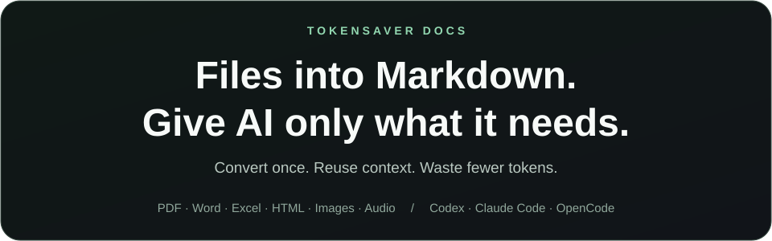

<p align="center"></p>

<p align="center">
<a href="https://github.com/winter0123/tokensaver-docs/releases/download/v0.4.0/tokensaver-docs-win32-x64.zip?download=1"></a>
<a href="https://github.com/winter0123/tokensaver-docs/releases/download/v0.4.0/tokensaver-docs-darwin-arm64.zip?download=1"></a>
<a href="https://github.com/winter0123/tokensaver-docs/releases/download/v0.4.0/tokensaver-docs-darwin-x64.zip?download=1"></a>
</p>
<p align="center"><a href="#source-install">Linux · Source install</a> · <a href="https://github.com/winter0123/tokensaver-docs/releases">All releases</a></p>

<p align="center"><a href="README.md">English</a> · <a href="README.zh-CN.md">简体中文</a> · <a href="README.ja.md">日本語</a> · <a href="README.ko.md">한국어</a></p>

**Convert PDF, Word, Excel, HTML, images and audio into reusable Markdown for Codex, Claude Code and OpenCode.**

Click your OS button to download, then choose your agent in the installer.

<a id="download"></a>

## Download and install — v0.4.0

The buttons above download the ZIP immediately. Extract the entire archive, run its installer, then choose **1 Claude Code / 2 Codex / 3 OpenCode**. No separate Python is needed.

macOS: double-click `install.command`, or run `sh install.command` in the extracted folder.

Windows: open PowerShell in the extracted folder and run `.\install.ps1`. If device policy blocks it, follow your device policy; the installer does not change it.

Your chosen agent CLI must already be installed. Restart the agent after installation and ask **“Convert this HTML file to Markdown: /path/to/policy.html.”** To change models, ask **“Change the tokensaver-docs image conversion model.”**

macOS arm64 installer was exercised locally. Windows/Intel Mac passed binary bundle tests; the unified Windows launcher and real Windows/Intel host installation remain experimental. Binaries are unsigned/not notarized. Linux currently has source installation only.

<details>
<summary>Advanced: individual agent archives</summary>

| Operating system | Claude Code | Codex | OpenCode |
| --- | --- | --- | --- |
| macOS Apple Silicon | [ZIP](https://github.com/winter0123/tokensaver-docs/releases/download/v0.4.0/tokensaver-docs-claude-darwin-arm64.zip) | [ZIP](https://github.com/winter0123/tokensaver-docs/releases/download/v0.4.0/tokensaver-docs-codex-darwin-arm64.zip) | [ZIP](https://github.com/winter0123/tokensaver-docs/releases/download/v0.4.0/tokensaver-docs-opencode-darwin-arm64.zip) |
| macOS Intel | [ZIP](https://github.com/winter0123/tokensaver-docs/releases/download/v0.4.0/tokensaver-docs-claude-darwin-x64.zip) | [ZIP](https://github.com/winter0123/tokensaver-docs/releases/download/v0.4.0/tokensaver-docs-codex-darwin-x64.zip) | [ZIP](https://github.com/winter0123/tokensaver-docs/releases/download/v0.4.0/tokensaver-docs-opencode-darwin-x64.zip) |
| Windows x64 | [ZIP](https://github.com/winter0123/tokensaver-docs/releases/download/v0.4.0/tokensaver-docs-claude-win32-x64.zip) | [ZIP](https://github.com/winter0123/tokensaver-docs/releases/download/v0.4.0/tokensaver-docs-codex-win32-x64.zip) | [ZIP](https://github.com/winter0123/tokensaver-docs/releases/download/v0.4.0/tokensaver-docs-opencode-win32-x64.zip) |

</details>

## Use it by asking your agent

Install the plugin, restart your agent, then ask normally. You do not have to type the plugin name or a terminal command.

> Convert this HTML file to Markdown: /path/to/policy.html

> Convert the documents in this folder to Markdown: /path/to/documents

> Extract the text and describe this image in Markdown: /path/to/photo.png

> I want to change the conversion model. Show me my options.

Your agent selects TokenSaver Docs from the installed skills and tools based on your request. Answer any first-use model or image-handling questions, then check the actual saved paths and any partial/review-needed status.

If the agent chooses another approach, you can say “Use tokensaver-docs for this task.” Automatic selection depends on the agent and is not guaranteed just by installing the plugin.

<a id="source-install"></a>

## Install the source CLI

**Choose your operating system.** Requires Python 3.11+ and Git.

<details open>
<summary><strong>macOS / Linux — paste into your terminal</strong></summary>

```sh
python3 -m venv "$HOME/.tokensaver-docs/venv"
source "$HOME/.tokensaver-docs/venv/bin/activate"
python -m pip install 'tokensaver-docs[mcp,tokens] @ git+https://github.com/winter0123/tokensaver-docs.git'
```

In a new terminal, run the second line again.

</details>

<details>
<summary><strong>Windows — paste into PowerShell</strong></summary>

```powershell
py -3 -m venv "$HOME\.tokensaver-docs\venv"
& "$HOME\.tokensaver-docs\venv\Scripts\Activate.ps1"
python -m pip install 'tokensaver-docs[mcp,tokens] @ git+https://github.com/winter0123/tokensaver-docs.git'
```

In a new terminal, run the second line again. If activation is blocked, use `& "$HOME\.tokensaver-docs\venv\Scripts\tokensaver-docs.exe"` instead of `tokensaver-docs` below, without changing execution policy.

</details>

## Choose or change a model

**These commands are for source CLI users.** Plugin users can ask their agent to change the model as described above. Choose one service if you want visible image text and descriptions. Run commands in a terminal with the installed environment activated. Use the same command for initial setup and later changes; your model becomes the saved default.

<details>
<summary><strong>① Claude Code — use your signed-in CLI</strong></summary>

Install and sign in to the Claude Code CLI first. Run this, then **enter the exact model name available to your account**.

```sh
tokensaver-docs configure --kind image --provider claude
```

</details>

<details>
<summary><strong>② Codex — use your signed-in CLI</strong></summary>

Install and sign in to the Codex CLI first. Run this, then **enter the exact model name available to your account**.

```sh
tokensaver-docs configure --kind image --provider codex
```

</details>

<details>
<summary><strong>③ OpenCode + OpenRouter — choose from free model candidates</strong></summary>

Set the `OPENROUTER_API_KEY` environment variable first. Run this, then **choose a number from the free image-input model candidate list**. Actual availability depends on your account and the service. Do not share keys in agent chat.

```sh
tokensaver-docs configure --kind image --provider openrouter
```

OpenCode is the agent; OpenRouter is the model service. This does not change OpenCode's chat model. Claude Code and Codex users can also select OpenRouter as the conversion provider.

</details>

Plain document text needs no model or API key. These settings change the **image conversion model**, independently of your agent's chat model and audio model. Claude Code/Codex use their CLI authentication, usage limits, and billing conditions.

Check your model: `tokensaver-docs setup-model`

## Usage

Replace `./documents` with a file or folder. Results go into `./converted`. **Example: `policy.html` → `converted/policy.html.md`.**

**Extract text and mark image positions with `[이미지]`**

```sh
tokensaver-docs prepare "./documents" --output "./converted" --image-mode placeholder
```

**Include images, visible image text, and descriptions** — configure your model first. Images are sent to the selected provider.

```sh
tokensaver-docs prepare "./documents" --output "./converted" --image-mode analyze
```

Claude Code/Codex image support cannot be verified automatically. Add `--allow-unverified-model` only after checking image support yourself; known incompatible models remain blocked. Audio requires separate setup in the [advanced guide](docs/advanced-usage.md).

Existing Markdown and user edits are preserved. Identical documents and completed image analysis are reused from cache.

## Supported files

| File | Extensions | Markdown content |
| --- | --- | --- |
| PDF | `.pdf` | Text; image analysis of selected scanned pages |
| Word | `.docx` | Text, tables, embedded images |
| Excel | `.xlsx` | Sheets, cells, embedded images |
| HTML | `.html`, `.htm` | Body content, tables, embedded images |
| Images | `.png`, `.jpg`, `.jpeg`, `.webp`, `.bmp`, `.tif`, `.tiff`, `.gif` | Preserved images, optional text and descriptions |
| Audio and video audio tracks | `.wav`, `.mp3`, `.m4a`, `.ogg`, `.flac`, `.aac`, `.mp4` | Speech converted to text; video frames are not analyzed |

Legacy `.doc`/`.xls` files are unsupported. Image/audio quality depends on the model. Token savings depend on the document and retrieved scope; see [benchmarks and limitations](benchmarks/README.md).

## More

[Agent connections, search, audio, development](docs/advanced-usage.md) · [Plugin installation and distribution](docs/distribution.md) · [Verification status](docs/current-status.md) · [Report an issue](https://github.com/winter0123/tokensaver-docs/issues) · [MIT license](LICENSE)
